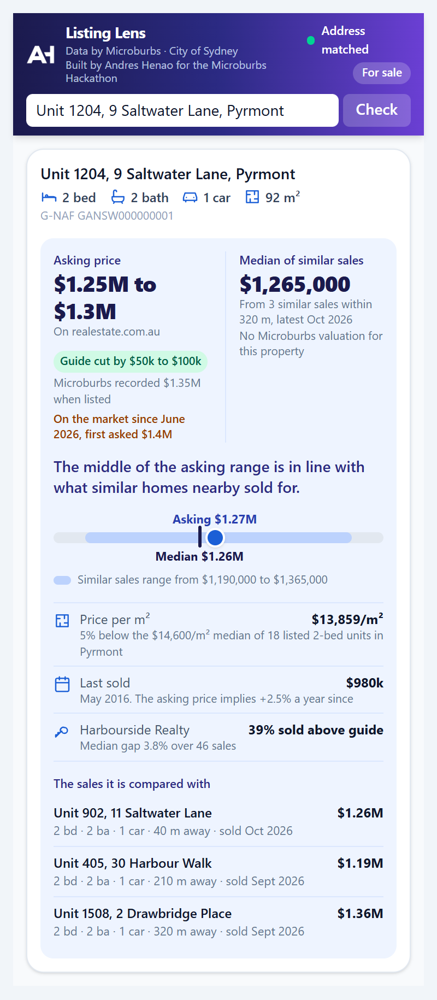
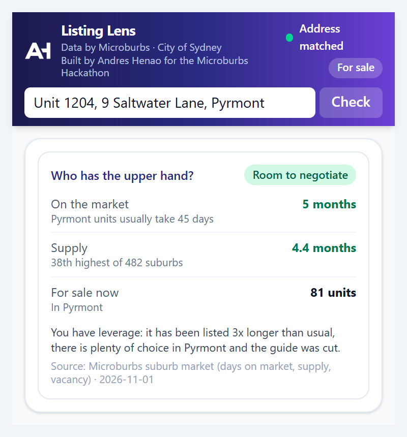
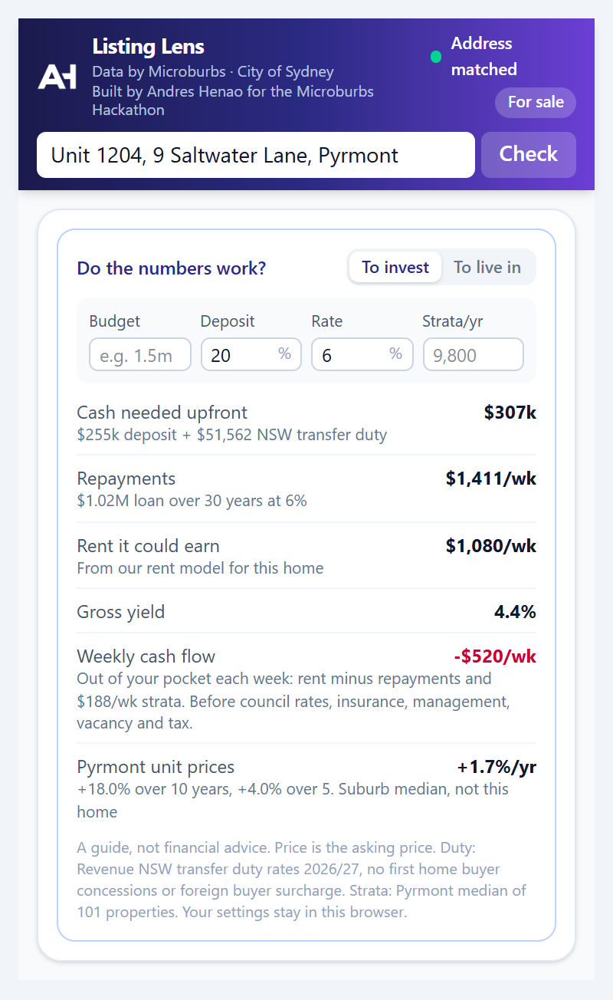
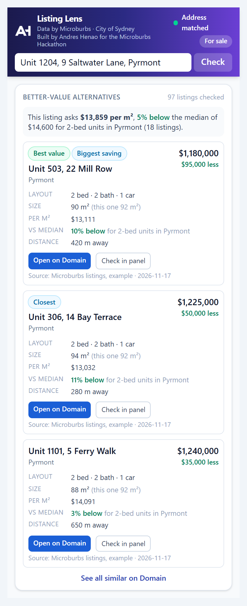
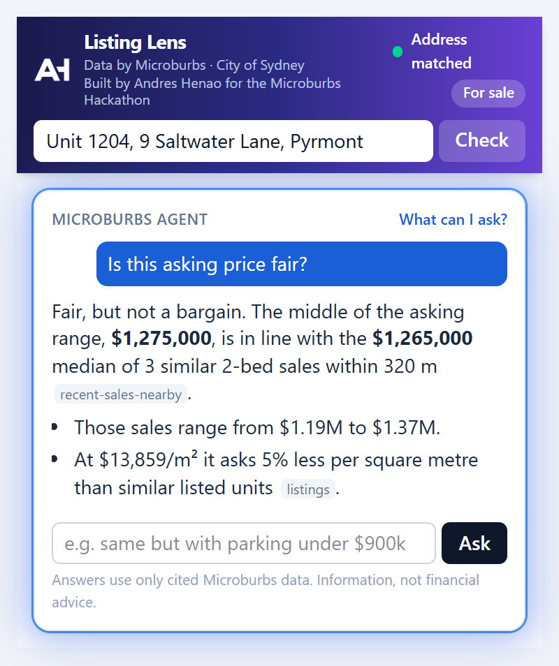
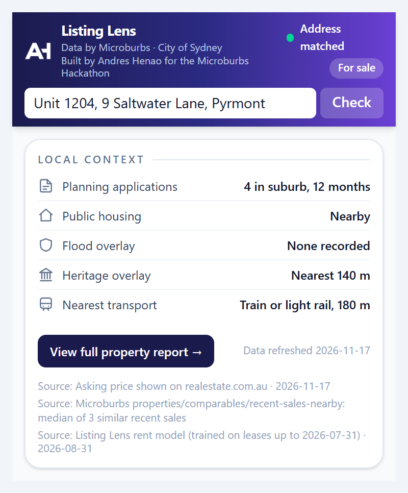
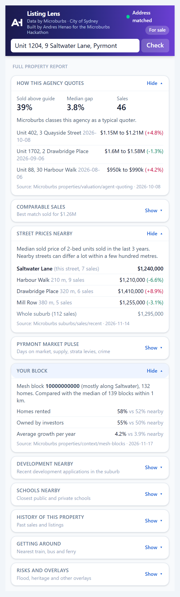

# Listing Lens

A Chrome extension that shows Microburbs data for the exact unit beside listings on domain.com.au and realestate.com.au in the City of Sydney: is the price fair, what is the catch, and is there something better nearby. Every number carries its source and date.

Built by Andres Henao for the [Microburbs](https://www.microburbs.com.au/) hackathon, 7 November 2026 (Task 3, Chrome extension; Task 4, flat rent model), run with UTS and Data Science Sydney. An independent project that uses Microburbs data; it is not a Microburbs product and is not endorsed by Microburbs, realestate.com.au or Domain.

Website: [lens.andreshenao.com.au](https://lens.andreshenao.com.au)

## The panel

Screenshots of the panel with an example listing (Unit 1204, 9 Saltwater Lane, Pyrmont). The address, figures and agency are illustrative; on a real listing every number comes from the Microburbs API with its source and date.

**Is the price right?** The address is matched to one G-NAF unit. The asking price sits beside the median of similar nearby sales, with the price per square metre, the last sale and how the agency usually quotes.



**Who has the upper hand?** How long it has been for sale, counting earlier listings, against how fast homes usually sell in the suburb, plus supply and any cut to the guide.



**Do the numbers work?** Cash needed upfront with NSW stamp duty, repayments, strata, the rent it could earn, cash flow and the suburb trend. Your own budget, deposit and rate stay in your browser.



**Better value nearby.** Similar listings close by asking less, with the saving, size, price per square metre and distance.



**Just ask.** The assistant answers only from cited Microburbs data.



**What is around it.** Development applications, public housing, flood and heritage overlays, and the nearest transport.



**Dig deeper.** The full report: agency quoting, comparable and street sales, the suburb market, your census block, development, schools, history, transport and risks.



**Renting?** On a rental the same panel switches to renter mode: fair rent from our model (with and without a car space), room to negotiate from days listed and suburb vacancy, the last lease, cheaper rentals nearby and a weekly budget check.

## Install (about 30 seconds)

Chrome only installs extensions without extra clicks from the Web Store, so the installer does everything else and leaves you two clicks.

**Windows** (PowerShell):

```powershell
irm https://raw.githubusercontent.com/cryptotweezer/listing-lens/main/install/install.ps1 | iex
```

**macOS / Linux**:

```sh
curl -fsSL https://raw.githubusercontent.com/cryptotweezer/listing-lens/main/install/install.sh | sh
```

Then, in the Chrome tab that opens:

1. Turn on **Developer mode** (top right).
2. Click **Load unpacked** and pick the folder the installer opened (`%LOCALAPPDATA%\ListingLens` on Windows, `~/ListingLens` on macOS).

### Manual install

1. Download `listing-lens.zip` from the [latest release](https://github.com/cryptotweezer/listing-lens/releases/latest) and unzip it.
2. Open `chrome://extensions`, turn on **Developer mode**, click **Load unpacked** and select the unzipped folder.

### Use it

Open any City of Sydney listing, for example in Pyrmont, Ultimo or Surry Hills, and click the Listing Lens icon in the toolbar. The side panel opens beside the listing.

## What it does

The panel reads top to bottom.

**Header.** The address from the listing, whether it matched, and whether the listing is for sale or for rent. For sale or for rent comes from Microburbs' own listings index. If the property is not in that index, the panel says the mode is a guess and lets you switch it. You can also type an address and press Check.

**Address match.** A clear listing resolves to one G-NAF unit and the overview opens. An unclear one stops on an address card: a list of units to pick from, an address the portal withheld, or outside the 29 City of Sydney suburbs. Nothing below that card loads until a unit is chosen. A typed address with no unit is a known limit: G-NAF has a record for the building itself, so that match shows building-level data instead of asking which unit.

**Price.** The matched address, beds, baths, cars, size and G-NAF id. Then the asking price beside the estimate. The asking price is read from the listing page (a single price or a range), so it is as current as the portal; Microburbs' recorded price is shown when it differs. The estimate is the Microburbs valuation when there is one. When there is none, the panel says so and shows the median of similar nearby sales instead, never presented as a Microburbs figure. A sentence says how far the asking price is from it, and a bar places both on the range of sales. The similar sales are like for like (same bedrooms and type), counted once even when Microburbs repeats a sale under several addresses, taken from the closest ring with enough of them (500 m, then 1 km, then 1.5 km), and listed with distance and date. When there are few or far away, the panel flags a weak comparison and does not call the price high or low. Under it: the guide cut or raised since listing, how long the home has been on the market (counting earlier listings), price per m² against similar listings, the home's last sale and the yearly growth the asking price implies, and how the agency usually quotes. For a rental, fair rent comes from our model (with a car space and without).

**Who has the upper hand.** Days on the market against the suburb's typical days, months of supply and how many similar homes are for sale (rental vacancy for a rental), plus any cut in the guide. A label (room to negotiate, balanced, competitive) and one sentence say why.

**Do the numbers work?** To invest or to live in. Budget, deposit, rate and strata are editable (strata starts at the suburb median from Microburbs). It shows cash needed upfront with NSW transfer duty (Revenue NSW 2026/27 rates, no concessions), weekly repayments, the rent the home could earn from our rent model, gross yield against the suburb, weekly cash flow, owning against renting the same home, the suburb's price trend over 10 and 5 years, and the budget check. Settings stay in this browser. For a rental it checks the weekly budget.

**Microburbs Agent.** A chat under the overview. Suggested questions cover the fair price, room to negotiate, the catch, cheaper options, comparisons, price trend, development, suburbs, the agency and the block. Answers use cited Microburbs data, and the repayment calculator includes NSW transfer duty. On a rental the suggestions switch to rent, transport and risks.

**Local context.** Planning applications in the suburb over 12 months, public housing, flood, heritage, and the nearest train, light rail, ferry or bus stop. A button scrolls to the full report, and every figure keeps its source and date.

**Better-value alternatives.** Up to three similar listings nearby, with the saving, beds and baths, size, price per square metre, and distance. Each one can be opened on Domain or checked in the panel. If the listing has no asking price, the card shows similar listings instead of cheaper ones.

**Full property report.** Collapsed cards, loaded when opened: how this agency quotes, comparable sales, street prices nearby, the suburb market pulse, your census block, development applications, schools, sale and rent history, transport, and risks and overlays. Sale-only cards are hidden on a rental.

## Who it helps

Buyers and renters looking at a City of Sydney flat who want to know, beside the listing, whether the price is fair and what the listing does not say. Investors get yield against the suburb and the agency's quoting pattern.

## The clever step

Most tools show facts for the building or the suburb. Listing Lens resolves a full listing address to one G-NAF unit first, and stops to ask when that unit is unclear, so the numbers are about the flat on screen. A typed address with no unit still matches the building record. The same unit-level rent model that we built for Task 4 drives the fair rent in the panel.

## Task 4: flat rents

The model predicts a weekly rent with and without a car space for all 65,777 flats in the Task 4 file (`rents.csv`, not published here because the flat list comes from the organisers; the panel reads the same predictions from the server). On our own time holdout (2,210 leases from April and May 2026, features stopped at 31 March) the median absolute error was $52.44 a week, 74.8% within $100, R² 0.837, against the published $86 and 55.2% for the Microburbs model. Method and limits are in [report.html](report.html). The pipeline is in `ml/` (`cd ml && uv run pytest`). The organisers' Task 4 files are not committed; to rebuild the CSV, put them in `data/raw/task4/` and follow [ml/README.md](ml/README.md).

## Data and credits

- Property, suburb and listing data: [Microburbs](https://www.microburbs.com.au/), through the [Microburbs API](https://www.microburbs.com.au/developers/api-docs) key provided for the hackathon. Thanks to Microburbs for the data and for running the event. For data beyond the City of Sydney, or for your own product, contact Microburbs.
- Task 4 training data: the organisers' files, not included here.
- Addresses: G-NAF, © Geoscape Australia, licensed under the Open G-NAF End User Licence Agreement.
- Census blocks: Australian Bureau of Statistics, CC BY 4.0.

No API key, organiser file, API output or prediction file is stored in this repository.

## Privacy and safety

The extension reads two things from the listing page you open: the address and the published asking price. It does not crawl the portals, and it does not copy or store listings: the price is used for that one request and is not saved or logged. Nothing about the user is read. Calculator settings stay in this browser and are not sent to the server. API keys live on the server, never in the extension. The backend caps data spend per day, rate limits each connection and the assistant, and accepts requests only from this extension.

## Development

```bash
pnpm install
pnpm --filter web dev          # backend on :3000 (needs .env, see .env.example)
pnpm --filter extension dev    # extension with hot reload
pnpm -r typecheck && pnpm -r test
cd ml && uv run pytest         # rent model
```

Stack: Next.js 16 route handlers, WXT + React 19 (MV3 side panel), Zod contracts, Upstash Redis, AI SDK with Claude Haiku, Python + LightGBM for the rent model.
